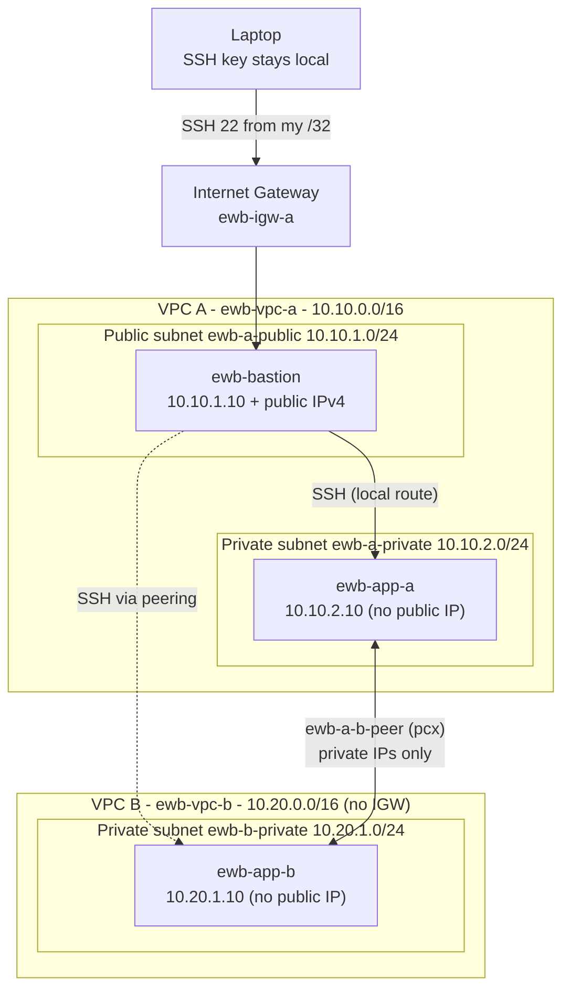

# AWS VPC Peering Lab: Private Connectivity Between Two VPCs

Connect two VPCs with **VPC peering**, keep both application servers **private**, administer them through a **single public bastion**, and **prove** it works with a failed baseline, successful two-way tests and a controlled failure.

> Built as an AWS Solutions Architect Associate hands-on project (EWB Cloud Labs, Project 01). Region: `ap-south-1` (Mumbai). Single AWS account, single Region.

## What this project demonstrates

- Non-overlapping VPC and subnet CIDR planning
- Public and private subnets with **explicit** route table associations
- VPC peering request, accept and activation
- Forward **and return** routes (plus the often-forgotten public-subnet route for ProxyJump)
- Least-privilege security groups (`/32` sources, no `0.0.0.0/0` for SSH or ICMP)
- Bastion access to private hosts with SSH `ProxyJump`, no keys copied to servers
- Evidence: baseline failure → success → controlled failure → recovery
- Clean teardown with verification

## Architecture



Administration path: `laptop → bastion → App-A / App-B` (SSH ProxyJump). Project traffic: `App-A ↔ App-B` over private IPs through the peering connection. Peering does **not** give VPC B internet access via VPC A.

More detail in [docs/architecture.md](docs/architecture.md).

## Address plan

| Resource (Name tag) | Location | CIDR / IP |
|---|---|---|
| ewb-vpc-a | VPC A | 10.10.0.0/16 |
| ewb-a-public | VPC A public subnet | 10.10.1.0/24 |
| ewb-a-private | VPC A private subnet | 10.10.2.0/24 |
| ewb-vpc-b | VPC B | 10.20.0.0/16 |
| ewb-b-private | VPC B private subnet | 10.20.1.0/24 |
| ewb-bastion | ewb-a-public | 10.10.1.10 + public IPv4 |
| ewb-app-a | ewb-a-private | 10.10.2.10 (no public IP) |
| ewb-app-b | ewb-b-private | 10.20.1.10 (no public IP) |

Other names: `ewb-igw-a`, route tables `ewb-rt-a-public` / `ewb-rt-a-private` / `ewb-rt-b-private`, security groups `ewb-sg-bastion` / `ewb-sg-app-a` / `ewb-sg-app-b`, peering `ewb-a-b-peer`, key pair `ewb-lab`. All resources are tagged `Project=EWB-VPC-Peering` and `Student=<your name>`.

## Final route tables

| Route table (subnet) | Destination | Target | Why |
|---|---|---|---|
| ewb-rt-a-public (ewb-a-public) | 10.10.0.0/16 | local | Bastion → App-A |
| | 0.0.0.0/0 | igw | Bastion internet / admin access |
| | 10.20.0.0/16 | pcx | Bastion's ProxyJump reaches App-B |
| ewb-rt-a-private (ewb-a-private) | 10.10.0.0/16 | local | VPC A internal |
| | 10.20.0.0/16 | pcx | App-A → VPC B (forward) |
| ewb-rt-b-private (ewb-b-private) | 10.20.0.0/16 | local | VPC B internal |
| | 10.10.0.0/16 | pcx | Replies / App-B → VPC A (return) |

## Security group inbound rules

| Security group | Protocol / port | Source | Purpose |
|---|---|---|---|
| ewb-sg-bastion | TCP 22 | my public IPv4 `/32` | Admin from my laptop only |
| ewb-sg-app-a | TCP 22 | 10.10.1.10/32 | SSH from bastion only |
| ewb-sg-app-a | ICMP echo request (type 8, code 0) | 10.20.1.10/32 | Ping from App-B only |
| ewb-sg-app-b | TCP 22 | 10.10.1.10/32 | SSH from bastion (its **private** IP is the source seen by App-B) |
| ewb-sg-app-b | ICMP echo request (type 8, code 0) | 10.10.2.10/32 | Ping from App-A only |

Outbound is left at the default allow-all; security groups are stateful so replies are automatic. Network ACLs are default allow-all.

## Prerequisites

- AWS lab account with permission for VPC, EC2 and key pairs; **AWS CLI v2** configured (`aws configure`, or SSO)
- Bash (Linux, macOS, or WSL on Windows), OpenSSH client, `curl`
- Check current pricing and credits: EC2 (`t3.micro` ×3), EBS (3 × 8 GiB gp3) and the bastion's **public IPv4** are chargeable. **No NAT gateway is used.**

## Quick start (CLI)

```bash
git clone https://github.com/<you>/aws-vpc-peering-lab.git && cd aws-vpc-peering-lab
nano config.env                       # set STUDENT_NAME, confirm Region/AZ

scripts/01-network.sh                 # VPCs, subnets, IGW, route tables + associations
scripts/02-security-groups.sh         # 3 SGs with /32 rules
scripts/03-compute.sh                 # key pair + bastion, App-A, App-B
scripts/04-ssh-config.sh              # generates ssh/ssh_config (ProxyJump)

ssh -F ssh/ssh_config ewb-bastion     # verify, then exit
ssh -F ssh/ssh_config ewb-app-a       # works via VPC A's local route

scripts/tests.sh baseline             # TEST 01: expect 100% packet loss (no peering yet)

scripts/05-peering.sh                 # request + accept -> Active
scripts/tests.sh baseline             # optional: still fails - Active peering is NOT enough
scripts/06-routes.sh                  # forward + return + public-subnet routes

scripts/tests.sh all-after-routes     # TESTS 02-05 + route dump
scripts/tests.sh failure              # controlled failure + recovery
scripts/inventory.sh                  # resource table for your report

scripts/99-cleanup.sh                 # tear down + verify (save evidence first!)
```

Every test writes real output to `evidence/logs/`. Prefer the console? Follow [docs/console-walkthrough.md](docs/console-walkthrough.md); the validation steps are identical.

## Test matrix (acceptance criteria)

| # | Test | Where / command | Expected |
|---|---|---|---|
| 01 | Baseline | App-A (before peering): `ping -c 4 10.20.1.10` | No replies (100% loss) |
| 02 | Forward path | App-A (after routes): `ping -c 4 10.20.1.10` | 4 replies, 0% loss |
| 03 | Reverse path | App-B (after routes): `ping -c 4 10.10.2.10` | 4 replies, 0% loss |
| 04 | Private SSH | Laptop: `ssh ewb-app-b` | Shell on App-B through the bastion |
| 05 | Isolation | EC2 details for App-A / App-B | No public IPv4 |
| 06 | Controlled failure | Remove App-B's ICMP rule, ping from App-A | 100% loss; restore → 0% loss |

Details and how to capture evidence: [docs/validation.md](docs/validation.md).

## Results

> **Replace this section with your own output.** Results must come from *your* AWS run; paste the log snippets from `evidence/logs/` and add screenshots to `evidence/screenshots/`.

| Test | Result | Evidence |
|---|---|---|
| 01 Baseline | _pending_ | `evidence/logs/…01-baseline…` |
| 02 Forward | _pending_ | |
| 03 Reverse | _pending_ | |
| 04 Private SSH | _pending_ | |
| 05 Isolation | _pending_ | |
| 06 Failure → recovery | _pending_ | |
| Cleanup verified | _pending_ | |

## Repository layout

```
.
├── README.md
├── config.env                  # all tunable values
├── docs/
│   ├── architecture.md         # design + why every route / rule exists
│   ├── console-walkthrough.md  # same lab via the AWS Console
│   ├── validation.md           # tests, expected output, controlled failure
│   ├── troubleshooting.md
│   ├── viva-qa.md              # model answers to the 4 viva questions
│   └── cleanup-and-cost.md
├── scripts/                    # AWS CLI automation (01..06, tests, inventory, 99-cleanup)
├── ssh/config.example
└── evidence/
    ├── REPORT_TEMPLATE.md      # fill in -> export to YourName_EWB_VPC_Peering.pdf
    ├── logs/                   # created by scripts/tests.sh
    └── screenshots/
```

## Key concepts

- **Peering is the link; routes and security groups decide what uses it.** Active peering alone never makes ping or SSH work.
- **Routes are needed in both directions.** Without the return route the reply has nowhere to go.
- **Peering is one-to-one and non-transitive.** A–B plus A–C does not give B–C.
- **No edge-to-edge routing.** VPC B cannot use VPC A's internet gateway over the peering connection.
- **CIDRs must not overlap**, including secondary CIDRs. Different subnet ranges don't fix overlapping VPC ranges.

## Security notes

- Never commit `*.pem`, `state.env` or `ssh/ssh_config` (already in `.gitignore`). Never copy the private key to any EC2 instance.
- Never open SSH or ICMP to `0.0.0.0/0`. Update the bastion rule if your public IP changes.
- Instances enforce IMDSv2 (`HttpTokens=required`) and use small, delete-on-termination root volumes.
- Before pushing evidence, scrub AWS account IDs, public IPs and anything you consider sensitive.

## References (official AWS docs)

- VPC peering concepts and limitations · Create a VPC peering connection · Update route tables for a VPC peering connection · Security groups for peered VPCs · Amazon EC2 key pair security · Amazon VPC pricing (search these titles on docs.aws.amazon.com)

## License

MIT, see [LICENSE](LICENSE).
